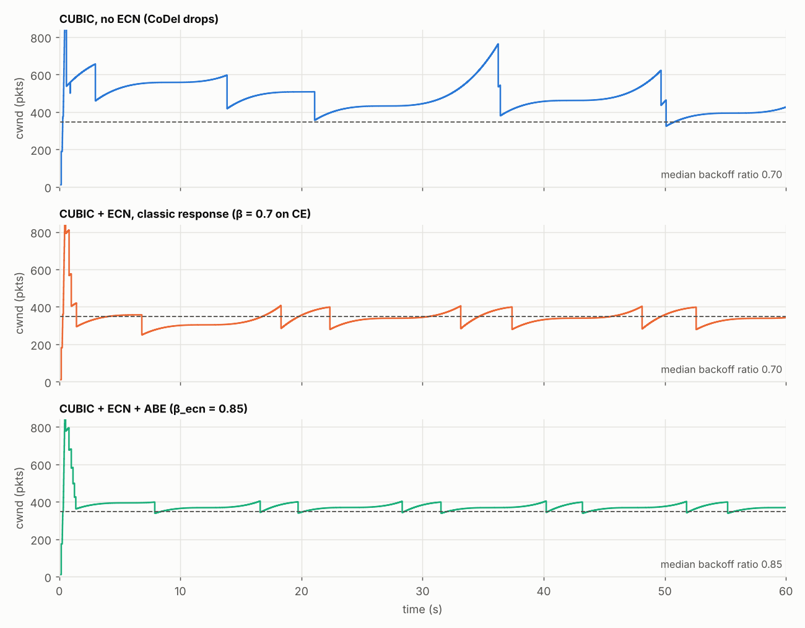

# picoquic ABE experiment scripts

Scripts I used to test Alternative Backoff with ECN (RFC 8511) for CUBIC in picoquic.

The picoquic change itself (in `picoquic/cubic.c`) is not part of this repo. It adds an option string to cubic: `-H R` uses beta = 0.7 for both loss and ECN, `-H A` enables ABE (0.7 on loss, 0.85 on ECN-CE).

## Setup

Dumbbell topology with network namespaces:

```
s1 --\                       /-- c1
      rl --- [bottleneck] --- rr
s2 --/                       \-- c2
```

s1/s2 run the picoquic servers (senders), c1/c2 the clients. My kernel had no netem or codel qdisc, so the bottleneck is a small userspace program (`emu/bneck.c`) that sits between the two routers and does the rate limit, delay, buffer and CoDel with ECN marking.

Link used for all runs: 50 Mbit/s, 80 ms RTT, 1000 packet buffer, CoDel (5 ms target, 100 ms interval). BDP is about 347 packets.

## Scripts

- `scripts/topo.sh up|down` - creates / removes the namespaces
- `emu/bneck.c` - bottleneck emulator, build with `gcc -O2 -o emu/bneck emu/bneck.c -lm`
- `scripts/run_experiments.py` - runs the scenarios and saves qlogs and queue logs in `results/`
- `scripts/parse_qlog.py` - pulls cwnd, CE echoes and losses out of the server qlogs
- `scripts/plot.py` - makes the graphs in `plots/` and `results/summary.md`

Running it (needs root):

```
gcc -O2 -o emu/bneck emu/bneck.c -lm
sudo env PICOQUIC=/path/to/picoquic python3 scripts/run_experiments.py noecn ecn abe
sudo python3 scripts/parse_qlog.py results/noecn results/ecn results/abe
python3 scripts/plot.py
sudo scripts/topo.sh down
```

`PICOQUIC` should point to a picoquic checkout with the ABE commit, built in `build/`.

Scenarios: `noecn`, `ecn`, `abe`, `stock_noecn`, `stock_ecn` (picoquic default cubic), `ecn_2flows`, `abe_2flows`.

## Results

Single flow:

| run | goodput | cwnd drop per CE | queue delay (median) | loss |
|---|---|---|---|---|
| no ECN | 46.0 Mbit/s | - | 17.6 ms | 5.4 % |
| ECN (beta 0.7) | 41.3 Mbit/s | 0.70 | 3.0 ms | 0 |
| ECN + ABE (beta 0.85) | 45.3 Mbit/s | 0.85 | 3.8 ms | 0 |



- With plain ECN, every CE mark cuts cwnd from ~400 to ~280 packets, which is below the BDP, so the link goes idle for a while after each backoff.
- With ABE it only drops to ~340, around the BDP, so the link stays full. That gives about 10% more throughput with the same short queue.
- Every CE backoff measured exactly 0.85 with ABE and 0.70 without. Losses still used 0.70 with ABE on.
- Without ECN, picoquic's cubic ignores single losses, so CoDel ends up dropping a lot of packets and the queue stays higher.
- With two flows the gain is small since the two flows rarely back off at the same time.

Per-run graphs (cwnd and queue delay) are in `plots/`.
